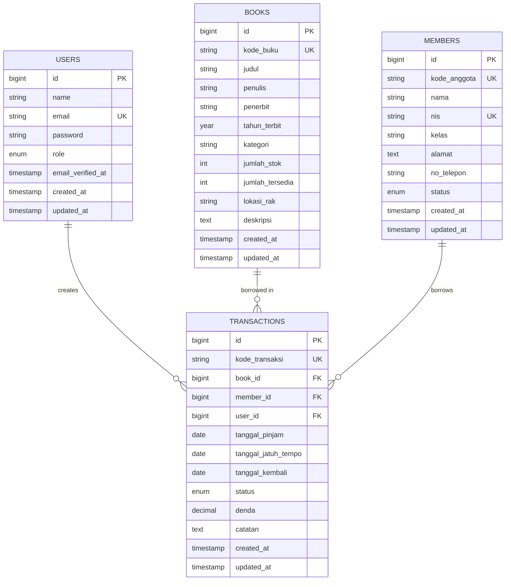

# Entity Relationship Diagram (ERD)

## Perpustakaan Sekolah Digital

### Entities and Relationships

## Relationship Details

### 1. USERS → TRANSACTIONS (One to Many)
- **Relationship**: One user can create multiple transactions
- **Foreign Key**: `transactions.user_id` references `users.id`
- **On Delete**: RESTRICT (cannot delete user who has transactions)

### 2. BOOKS → TRANSACTIONS (One to Many)
- **Relationship**: One book can be borrowed in multiple transactions
- **Foreign Key**: `transactions.book_id` references `books.id`
- **On Delete**: RESTRICT (cannot delete book with active transactions)

### 3. MEMBERS → TRANSACTIONS (One to Many)
- **Relationship**: One member can have multiple transactions
- **Foreign Key**: `transactions.member_id` references `members.id`
- **On Delete**: RESTRICT (cannot delete member with active transactions)

## Indexes

### USERS
- Primary Key: `id`
- Unique: `email`

### BOOKS
- Primary Key: `id`
- Unique: `kode_buku`
- Index: `kategori`
- Index: `judul`

### MEMBERS
- Primary Key: `id`
- Unique: `kode_anggota`, `nis`
- Index: `status`

### TRANSACTIONS
- Primary Key: `id`
- Unique: `kode_transaksi`
- Index: `status`
- Composite Index: `(book_id, status)`
- Composite Index: `(member_id, status)`
- Foreign Keys: `book_id`, `member_id`, `user_id`

## Business Rules

1. **Book Stock Management**:
   - `jumlah_tersedia` must always be ≤ `jumlah_stok`
   - When a book is borrowed, `jumlah_tersedia` decreases by 1
   - When a book is returned, `jumlah_tersedia` increases by 1

2. **Transaction Status**:
   - `dipinjam`: Book is currently borrowed
   - `dikembalikan`: Book has been returned on time
   - `terlambat`: Book was returned after due date or is still borrowed past due date

3. **Member Status**:
   - `aktif`: Member can borrow books
   - `nonaktif`: Member cannot borrow books

4. **User Roles**:
   - `admin`: Full access to all features
   - `user`: Limited access (can create transactions, view catalogs)

## Data Integrity Constraints

1. Books cannot be deleted if they have active transactions (status = 'dipinjam')
2. Members cannot be deleted if they have active transactions
3. Users cannot be deleted if they have transactions
4. `kode_buku`, `kode_anggota`, `kode_transaksi`, `nis`, `email` must be unique
5. All foreign key constraints use RESTRICT on delete
