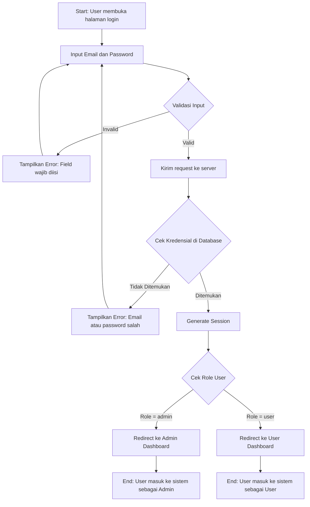

# Flowchart - Proses Login

## Alur Login Sistem Perpustakaan

## Deskripsi Proses

### Input
- Email user
- Password user
- Remember me (optional)

### Proses
1. **Validasi Form**: 
   - Email harus format email valid
   - Password tidak boleh kosong
   
2. **Autentikasi**:
   - Cari user berdasarkan email
   - Verifikasi password menggunakan hash
   - Jika cocok, buat session baru
   
3. **Authorization**:
   - Cek role user (admin atau user)
   - Redirect sesuai role
   
4. **Session Management**:
   - Regenerate session ID untuk keamanan
   - Set remember token jika user checklist "Ingat Saya"

### Output
- **Success**: 
  - Admin → Dashboard Admin
  - User → Dashboard User
  - Session aktif
- **Failed**: 
  - Error message
  - Redirect kembali ke form login

### Keamanan
- Password di-hash menggunakan bcrypt
- CSRF protection aktif
- Session regeneration setelah login
- Rate limiting untuk mencegah brute force

## File Terkait
- Controller: `app/Http/Controllers/Auth/LoginController.php`
- View: `resources/views/auth/login.blade.php`
- Route: `routes/web.php`
- Middleware: Session, CSRF
