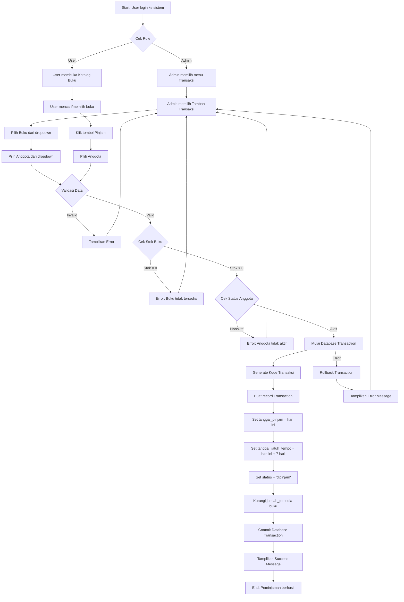

# Flowchart - Proses Peminjaman Buku

## Alur Peminjaman Buku

## Deskripsi Proses

### Input
- **Admin Flow**:
  - ID Buku (dari dropdown)
  - ID Anggota (dari dropdown)
  - Durasi peminjaman (default 7 hari)

- **User Flow**:
  - ID Buku (dari katalog)
  - ID Anggota (dari form)

### Proses

#### 1. Validasi Awal
- Validasi input tidak boleh kosong
- Validasi buku ada di database
- Validasi anggota ada di database

#### 2. Business Rule Check
- **Cek Stok**: `jumlah_tersedia > 0`
  - Jika stok habis, tolak peminjaman
  
- **Cek Status Anggota**: `status = 'aktif'`
  - Hanya anggota aktif yang bisa meminjam

#### 3. Create Transaction (dalam DB Transaction)
- Generate `kode_transaksi` unik: `TRX-YYYYMMDDHHMMSS-XXXX`
- Insert record ke table `transactions`:
  - `book_id`: ID buku yang dipinjam
  - `member_id`: ID anggota peminjam
  - `user_id`: ID user yang membuat transaksi
  - `tanggal_pinjam`: Tanggal hari ini
  - `tanggal_jatuh_tempo`: Tanggal hari ini + 7 hari
  - `status`: 'dipinjam'
  - `denda`: 0
  
#### 4. Update Stock
- Decrement `jumlah_tersedia` pada tabel `books`
- Query: `UPDATE books SET jumlah_tersedia = jumlah_tersedia - 1 WHERE id = ?`

#### 5. Commit atau Rollback
- Jika semua berhasil: Commit transaction
- Jika ada error: Rollback semua perubahan

### Output
- **Success**:
  - Record transaksi baru di database
  - Stok buku berkurang 1
  - Success message
  - Redirect ke halaman transaksi
  
- **Failed**:
  - Error message dengan alasan spesifik
  - Tidak ada perubahan data
  - Tetap di halaman form

### Business Rules
1. Satu transaksi = 1 buku + 1 anggota
2. Durasi peminjaman default: 7 hari
3. Denda dihitung saat pengembalian, bukan saat peminjaman
4. Transaksi menggunakan DB transaction untuk data consistency

## File Terkait
- **Service**: `app/Services/LibraryService.php` → `borrowBook()`
- **Controller**: 
  - Admin: `app/Http/Controllers/TransactionController.php` → `store()`
  - User: `app/Http/Controllers/BookController.php` → `borrow()`
- **Model**: 
  - `app/Models/Transaction.php`
  - `app/Models/Book.php`
  - `app/Models/Member.php`
- **Views**:
  - Admin: `resources/views/admin/transactions/create.blade.php`
  - User: `resources/views/user/books/catalog.blade.php`

## Validasi
- `book_id`: required, exists in books table
- `member_id`: required, exists in members table
- `durasi_hari`: integer, min:1, max:30
